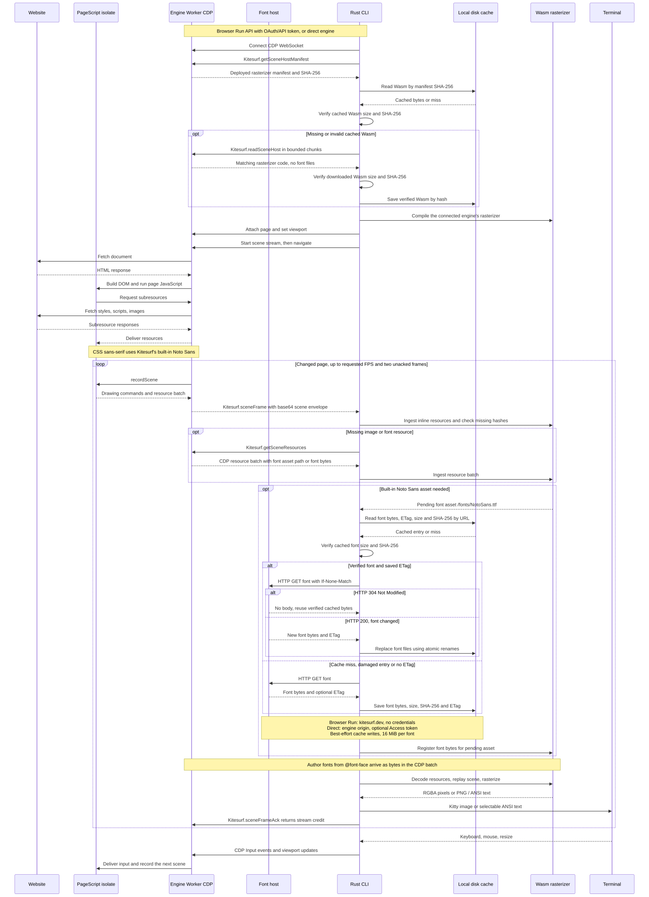

# Kitesurf CLI

Kitesurf opens websites in your terminal. It receives scenes over
CDP and renders them locally using Kitty graphics; use `--mode=ansi` for
selectable text in any terminal.

## How it works



The engine sends drawing commands over CDP. The CLI replays them with a
downloaded Wasm rasterizer, displays Kitty graphics or ANSI text, and
acknowledges each scene so the engine can send the next one.

By default, CDP connects through the official Browser Run API with
`browser=kitesurf`. After connecting, the CLI asks that engine for its
scene-host manifest over CDP. On a cache miss it downloads the matching
Wasm in chunks of up to 4 MiB, verifies its size and SHA-256, and caches
it by hash. A cache hit only needs the manifest. This also applies to
playground and direct/local connections, so each engine supplies its own
rasterizer. Scene wire-version checks remain in place before replay.

In Browser Run mode, built-in fonts come from `https://kitesurf.dev/rbi/fonts/`
without API or Cloudflare Access credentials. Direct connections, including
the playground, fetch `/rbi/fonts/` from the connected engine's origin and
send `CF_ACCESS_TOKEN` if set. Font redirects must stay on that origin.
Page-provided fonts still travel in CDP resource batches.

Built-in fonts are cached on disk in `$XDG_CACHE_HOME/kitesurf/fonts/`, or
`~/.cache/kitesurf/fonts/` when `XDG_CACHE_HOME` is unset. Each entry stores
the font bytes, their SHA-256 and size, and the server's ETag. On a later
run, the CLI checks the local bytes and sends `If-None-Match`; an HTTP 304
reuses those bytes without downloading the font again. A changed font or
damaged cache entry triggers a full download. Responses without an ETag
are downloaded again on the next run. Cache write failures do not prevent
rendering; `--debug` reports them. Individual fonts remain capped at 16 MiB.

The engine must support `Kitesurf.getSceneHostManifest` and
`Kitesurf.readSceneHost`. Deploy that support before installing this CLI
version. An older engine produces an upgrade error; the CLI does not fall
back to a different environment's rasterizer. The HTTP scene-host routes
remain available for older clients.

In graphics mode, localized changes arrive as damage-rectangle scenes. The
downloaded rasterizer composites them into a retained viewport, so the CLI
replays only the changed region. It still displays a complete image using
ordinary Kitty image placement, including on Ghostty. Navigation, resize,
or a missing base frame triggers a full scene. Older rasterizers and ANSI
mode use full scenes.

For example, `<p style="font-family: sans-serif">Hello</p>` uses Kitesurf's
built-in Noto Sans font even though the page provides no font file. The CDP
resource batch identifies it as `/fonts/NotoSans.ttf`. If the rasterizer needs
it, the CLI fetches `/rbi/fonts/NotoSans.ttf` from the font origin described
above and supplies the bytes to the Wasm. A font loaded by the page with
`@font-face` instead travels in the CDP resource batch. The separately downloaded
`scene_host.wasm` is the rasterizer program, not a bundle of fonts.

[Mermaid source](architecture.mmd) · [PNG](architecture.png)

## Install

From a checkout of this repository, with Rust 1.96 or later installed:

```sh
cargo install --path packages/kitesurf-cli --locked
```

This installs `kitesurf` in Cargo's bin directory (usually `~/.cargo/bin`).
On Linux the build compiles its TLS stack (Rustls on aws-lc-rs) with the
system C compiler and trusts the system certificate store. The credential
store integration builds vendored D-Bus and OpenSSL dependencies. macOS and
Windows use the platform's TLS.

The Rust package also exposes the `kitesurf_playback` library. `play` accepts a
connected `CdpSocket`, validated `PlaybackOptions`, and a `FontSource` containing
the font origin and its HTTP client. The CLI handles Browser Run authentication;
`PlaybackOptions::new` enforces the 1-60 FPS limit.

## Run

Open a page through Browser Run:

```sh
kitesurf https://example.com/
```

Without a saved login, the CLI starts OAuth automatically and opens the
requested page after you sign in. Run `kitesurf login` to sign in separately
or select a different account. Both `kitesurf --help` and
`kitesurf login --help` show the full usage and authentication instructions.

Login opens your browser for Cloudflare consent and listens on
`http://localhost:8976/oauth/callback` for up to five minutes. Choose the
account(s) to authorize, then select an account in the terminal if more
than one is available. Set `CLOUDFLARE_ACCOUNT_ID` before login to select a
specific authorized account without the terminal prompt.

The selected account, access token, refresh token, and expiry are saved in
the OS credential store: Keychain on macOS, Credential Manager on Windows,
or Secret Service on Linux. Linux login needs an unlocked Secret Service
keyring and a D-Bus session. Tokens nearing expiry refresh before a new
connection. If the token endpoint rejects the refresh grant (`invalid_grant`)
or no refresh token was issued, the CLI starts OAuth login again and continues
opening the requested page after you sign in. Network errors, timeouts, and
other token-endpoint failures keep the saved credentials and return an error
so you can try again.

If Browser Run rejects the saved OAuth token with HTTP 401, the CLI starts
OAuth login automatically, retries the connection once with the new credentials,
and opens the requested page. A failed login or rejected retry returns an error.
Explicit API tokens and direct engine connections do not start OAuth login.

`kitesurf logout` revokes the tokens and removes the saved login. If remote
revocation fails, it still removes the local login and tells you to revoke
the authorization in the Cloudflare dashboard.

For CI or terminals without a credential store, use an API token with
`Browser Rendering - Edit` permission:

```sh
export CLOUDFLARE_ACCOUNT_ID="<ACCOUNT_ID>"
export KITESURF_API_TOKEN="<API_TOKEN>"
kitesurf https://example.com/
```

`KITESURF_API_TOKEN` takes precedence over saved OAuth credentials and requires
an explicit account ID. `CLOUDFLARE_API_TOKEN` is ignored, so exported Wrangler
deployment credentials do not override your Kitesurf login. Neither Browser
Run tokens nor saved OAuth credentials are sent to the playground asset host.

To use the public playground without Cloudflare credentials:

```sh
kitesurf --playground https://example.com/
```

For selectable text, use `kitesurf --mode=ansi https://example.com/`.

### OAuth application setup

The CLI defaults to public client ID `c9007ad1-f329-4bc0-93b5-931f78e8e64e`,
with Authorization Code and Refresh Token grants, PKCE `S256`, token
authentication method `none`, and the exact redirect URI
`http://localhost:8976/oauth/callback`. No client secret is shipped or required.

Set `KITESURF_OAUTH_CLIENT_ID` to use another registered client, such as staging:

```sh
KITESURF_OAUTH_CLIENT_ID="<STAGING_CLIENT_ID>" kitesurf https://example.com/
```

The override applies to login, token exchange, refresh, and logout. Saved
credentials are separate for each client ID; use the same override when
browsing or logging out of that client. Switching to a client without saved
credentials starts OAuth automatically. Each client must allow the redirect
URI, grants, and scopes described here.

Configure the client's required scopes to allow `browser-rendering.write`
(Browser Run Write) and `account-settings.read` (Account Settings Read, for
`GET /client/v4/accounts`). Enable the `refresh_token` grant alongside
`authorization_code`; Cloudflare automatically allows the `offline_access`
protocol scope when refresh tokens are enabled. It is not a product scope
in the scope picker. Login explicitly requests both product scopes and
`offline_access`. Registration defines the allowed permissions; omitting
the authorization request's `scope` parameter produces an empty consent list.
Verify consent and a Browser Run session after registration changes.

A private client can only be authorized by members of its owning account.
Public distribution requires public client visibility and publisher domain
verification. An account administrator can also block new public OAuth grants.

## Running locally

Start the Kitesurf engine from the repo root, then run
the client in another terminal:

```sh
KITESURF_PORT=8799 KITESURF_INSPECTOR_PORT=9239 pnpm run dev
KITESURF_SERVER=http://127.0.0.1:8799 kitesurf https://example.com/
```

Running `kitesurf` without a URL shows command-line help. Local Kitty mode
needs a Kitty-graphics terminal such as Ghostty; ANSI mode works without one.

## Options

| Option                     | Description                                                                                                                                                                                  |
| -------------------------- | -------------------------------------------------------------------------------------------------------------------------------------------------------------------------------------------- |
| `--playground`             | Connect directly to kitesurf.dev. Cannot be combined with `KITESURF_SERVER`.                                                                                                                 |
| `--mode=kitty\|ansi`       | Choose Kitty graphics (default) or ANSI text.                                                                                                                                                |
| `--fps N`                  | Cap the scene rate (1–60; default 60).                                                                                                                                                       |
| `--seconds N`              | Stop replay after N seconds and print measurements.                                                                                                                                          |
| `--no-display`             | Measure replay without drawing to the terminal.                                                                                                                                              |
| `--debug` (or `--verbose`) | Log connection, artifact/cache, font download and scene-stream events to stderr. With the full-screen display, later events print after it closes; use `--no-display --debug` for live logs. |
| `--version`                | Print the CLI version.                                                                                                                                                                       |
| `-h`, `--help`             | Show command-line help.                                                                                                                                                                      |

## Environment variables

| Variable                   | Description                                                                                                                                                      |
| -------------------------- | ---------------------------------------------------------------------------------------------------------------------------------------------------------------- |
| `CLOUDFLARE_ACCOUNT_ID`    | Browser Run account ID. Overrides the saved OAuth account; required when using an explicit API token. Also selects an account during login.                      |
| `KITESURF_API_TOKEN`       | Browser Run bearer token, used instead of saved OAuth credentials. Sent only on the API WebSocket handshake. `CLOUDFLARE_API_TOKEN` is ignored.                  |
| `KITESURF_OAUTH_CLIENT_ID` | Override the official OAuth client ID, for example for staging. Saved OAuth credentials are separate per client ID.                                              |
| `KITESURF_SERVER`          | Direct engine URL, bypassing Browser Run and OAuth. Remote engines require HTTPS; HTTP is allowed on loopback for local development.                             |
| `CF_ACCESS_TOKEN`          | Cloudflare Access token for a direct engine's WebSocket handshake and font requests. Ignored in Browser Run mode. Font redirects must stay on the engine origin. |
| `KITESURF_KITTY_PNG`       | Use PNG instead of raw RGBA files in local Ghostty; useful for comparing rendering speed.                                                                        |

For example, to use an engine behind Cloudflare Access, run this once:

```sh
cloudflared access login -app=https://kitesurf.example.com
```

And then this every time:

```sh
CF_ACCESS_TOKEN=$(cloudflared access token -app=https://kitesurf.example.com) \
  KITESURF_SERVER=https://kitesurf.example.com \
  kitesurf https://example.com/
```

The stats bar is on by default. Press Ctrl-B to toggle it, or Ctrl-C to exit. Its `acct` value is
the server's accounted memory across the engine, page isolates, and renderer;
it omits untracked allocations and is not the Worker's total memory use.
